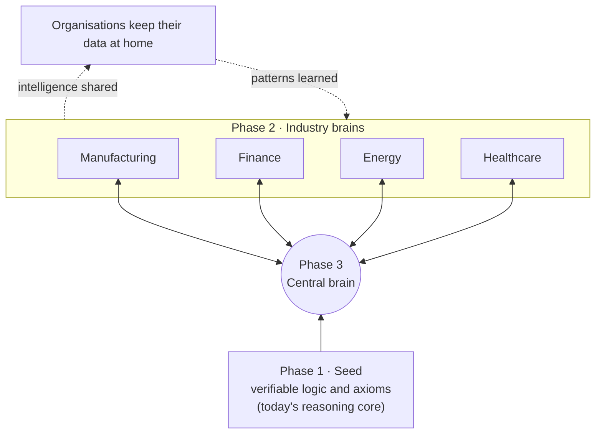

# MegaMind

**A sovereign AI system, built from scratch.**

MegaMind started as a curious Python experiment. It has become a first reasoning core: a system that learns from its own experience instead of relying on external AI models or APIs. The goal is to **own the intelligence stack**, from the first piece of logic upwards.

It is still primitive. But it is becoming a real learning system rather than a chatbot.

> **Current version: v0.5.1** · Next milestone: concept generalisation

---

## What it can do today

- **Store knowledge** that persists between sessions
- **Learn from experience:** it records what happened and uses it next time
- **Discover simple mathematical relationships** on its own
- **Compare strategies** and remember which ones succeed
- **Form basic concepts** and reinforce them through its interactions
- **Keep its intelligence separate from its interface:** the future agent, the intelligence core and the persistent knowledge are three distinct layers

## The next challenge: generalisation

Today, MegaMind recognises multiplication when it sees the `*` sign. It does not yet recognise the same idea when it is written differently:

| Input | v0.5.1 | Goal |
|---|---|---|
| `3 * 4` | ✓ multiplication | ✓ multiplication |
| `3 times 4` | not recognised | ✓ multiplication |
| `three groups of four` | not recognised | ✓ multiplication |
| `4 + 4 + 4` | not recognised | ✓ multiplication |

The next step is to move its first "neuron" from recognising **surface patterns** to extracting **concepts** it can reuse in new situations. Once that neuron can learn, abstract, generalise and reuse knowledge, it will be considered complete.

## Roadmap

- [x] Python experiment: first prototype
- [x] Reasoning core: persistent knowledge, experience, strategies, concepts (**v0.5.1**)
- [ ] Generalisation: concepts, not patterns
- [ ] A first complete neuron: learns, abstracts, reuses

## Long-term vision

Where MegaMind is heading: a sovereign architecture in three phases.



1. **Seed:** a system of verifiable logic and mathematical axioms. This is what MegaMind is building today.
2. **Industry brains:** each specialises in one sector and learns from organisations that keep their own data.
3. **Central brain:** connects every industry through **federated learning**. Only what is learned is shared, never the private data, so one organisation's progress becomes everyone's.

An interactive version of this architecture is on [josephsbeiti.github.io](https://josephsbeiti.github.io/#lab).

## Run it

```bash
python megamind.py
```

Requires Python 3.

---

An early-stage research project by [Joseph Sbeiti](https://josephsbeiti.github.io).
